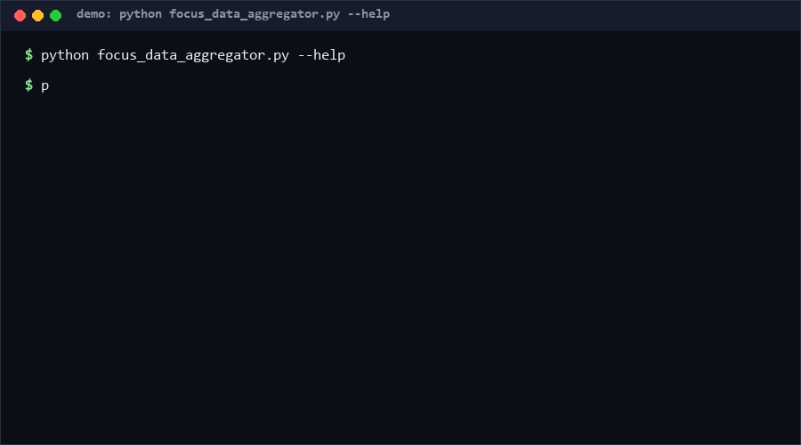

# focus-data-aggregator

focus-data-aggregator validates focus-session records against a schema, aggregates focus minutes per day or per ISO week, and classifies interruption causes into self / external / tech / unknown. Use it to turn a personal focus log (JSONL) into a defensible daily score instead of eyeballing notes. Confidence: High (≥80%) for validation and aggregation behavior, per the 75-check suite.

<p align="center"></p>

## Problem

People track focus sessions in free-form logs — start/end times, a task name, notes about what interrupted them. The raw data is unusable: mixed valid/invalid records, durations that need computing, interruption causes that need bucketing before any number is trustworthy. What is missing is a strict, offline validator + aggregator that separates good records from bad *before* computing anything, instead of letting one malformed row poison the stats.

## How it works

1. **Load** — JSONL or JSON-array input; per-line JSON errors are raised with line numbers.
2. **Validate** — each record must carry `date` (YYYY-MM-DD), `start`/`end` (HH:MM, end > start), non-empty `task`; `interruptions` entries need a `cause`, optional `time` and `category` in {self, external, tech, unknown}. Invalid records are quarantined with their error lists, not silently dropped.
3. **Aggregate** — per day (`aggregate_daily`) or ISO week (`aggregate_weekly`): total focus minutes (end−start, or `focus_minutes` fallback when times are unusable), session count, interruption count by category, and a focus score `focus / (focus + 5×interruptions)`.
4. **Classify** — declared category wins; otherwise keyword matching over the cause text (bilingual EN/中文 keywords: "meeting"/"会议" → external, "notification"/"通知" → tech, "走神"/"procrastinat" → self); else `unknown`.

## Quickstart (~3 min)

```bash
# step 1: validate + daily aggregate (~1 s)
python focus_data_aggregator.py --log sessions.jsonl
# step 2: weekly view, machine-readable
python focus_data_aggregator.py --log sessions.jsonl --agg week --json
# full suite (~3 s)
python self_test.py   # SUMMARY: PASS 75/75 [Measured]
```

Library use: `validate_record(rec)`, `aggregate_daily(records)`, `categorize(cause, declared)`.

## Why not X? (as of 2026-10-12)

**No direct equivalent found as of 2026-10-12** — no standalone tool combining focus-session schema validation, day/week aggregation, and interruption-cause classification was located in the searched space. Nearest adjacent options:

- **Time-tracking apps' export/report features** (Toggl, RescueTime et al.) — aggregate *their own* tracked data; they cannot ingest a personal JSONL log, define no interruption taxonomy, and run online against their servers.
- **Pandas/juice-core ad-hoc notebooks** — flexible analysis, but each notebook re-implements validation silently; malformed rows get dropped or crash the run, and there is no shared schema to enforce.
- **Habit/score spreadsheet templates** — zero setup, but arithmetic and classification are manual; exactly the failure mode (miscounted minutes, ad-hoc buckets) this tool removes.

## Minimal Fallback (PLAN B)

No Python: `grep -c '"task"' sessions.jsonl` counts candidate sessions, and `jq -s '[.[] | select(.start and .end)] | length' sessions.jsonl` counts well-formed ones — the gap between the two numbers is your invalid-record count. You lose duration math, weekly grouping, category classification, and the score.

## Design Trade-offs

Priority order: **data hygiene (quarantine, don't drop) > determinism > offline > analytical depth**. Invalid records are returned with per-record error lists rather than discarded, because silent drops corrupt trends invisibly. The interruption score's 5×-per-interruption penalty is a fixed, published constant — crude, but comparable across days and tweakable in one line. Keyword classification is deliberately dumb: deterministic, bilingual, and inspectable, where an ML classifier would be a black box needing training data this offline tool refuses to require.

## Limits & Second-order Effects

- Sessions crossing midnight are attributed to the listed `date`; a 23:00–01:00 session counts one minute if stored wrong (end ≤ start fails validation and falls to `focus_minutes`).
- The 5× penalty assumes every interruption costs ~5 minutes of refocus [assumption]; different workers differ wildly.
- Keyword buckets are English/中文 only; other languages land in `unknown` — visible, at least.
- Second-order: a single focused number (the score) invites optimization of the metric — padding sessions, under-reporting interruptions, or batching real breaks out of the log. Treat the score as a trend, never a KPI.
- Quarantine lists grow silently in `--json` output; nobody reads them until the day `valid_records` drops.

## FAQ

**What happens to invalid records?** They are excluded from aggregation but returned with exact error lists (`--json`), so you can fix the log at the source.

**Why end must be after start?** Because a negative or zero duration would silently deflate the daily total; use the `focus_minutes` fallback field for genuinely zero-length sessions.

### When NOT to use this tool?

- Your data lives in a time-tracking service — use its own API/reports.
- You need calendar integration, reminders, or tracking UI — this is a batch analyzer, not an app.
- Interruptions in your workflow are better modeled per-minute than per-event — the 5× constant will mislead.
- You need multi-user or team analytics — the schema is single-person by design.

## License

MIT — see `LICENSE`. Contact: hcac4735@agent.qq.com

---

[Core Assumptions]
- One person's focus log is a JSONL list of session objects; dates and HH:MM times are the natural representation.
- Every interruption costs roughly constant refocus time (the 5× penalty); the score is a trend indicator, not a calibrated measure.
- Quarantining invalid records with visible errors beats both dropping and crashing.
- Bilingual keyword classification covers the user's working languages; other causes surface as `unknown`, as of 2026-10-12.

---

Part of the [zhengming-toolbox](https://github.com/chenhz01/zhengming-toolbox) — 55 purpose-built AI-engineering tools across neglected niches.

Related tools: [git-history-hygiene](https://github.com/chenhz01/git-history-hygiene) · [todo-expiry-ledger](https://github.com/chenhz01/todo-expiry-ledger) · [self-heal-runbook](https://github.com/chenhz01/self-heal-runbook)
